## Task 2.2 Segmentation: Hip MRI Anatomical Structure Segmentation

# Comparison of 2D and 3D U-Net Architectures for Hip MRI Segmentation

### Problem
The beneficiaries of the proposed system are patients undergoing hip MRI imaging and the medical professionals responsible for interpreting the resulting scans. The intended end users are clinicians who can utilise the segmentation tool to assist in identifying anatomical structures, verifying suspected regions of concern, and detecting segmentation boundary leakage that may indicate areas requiring further investigation.

The objective of this project is to perform semantic segmentation of pelvic MRI scans using U-Net based deep learning architectures. The task involves automatically assigning each pixel or voxel within an MRI scan to one of several anatomical structures, allowing clinically relevant regions to be isolated from surrounding tissue. The target structures include the body, bone, bladder, colon, and prostate, together with a background class.

U-Net is a convolutional neural network architecture specifically designed for image segmentation. As shown in Figure 1, the network consists of a contracting encoder path and an expanding decoder path connected through skip connections. The encoder extracts increasingly abstract features from the input image, while the decoder reconstructs the segmentation map from these learned features. The skip connections preserve spatial information lost during down-sampling, enabling precise localisation of boundaries and improving accuracy.

A two-dimensional U-Net architecture was implemented as a baseline model and comparisons will be made with a 3D U-Net structure using the Sorensen-Dice score as an accuracy metric and compute times and memory consuption will also be used for comparing the effectiveness/tradeoofs of the models. 

Figure 1: Unet structures (Image from Sovit Ranjan Rath, 2023)
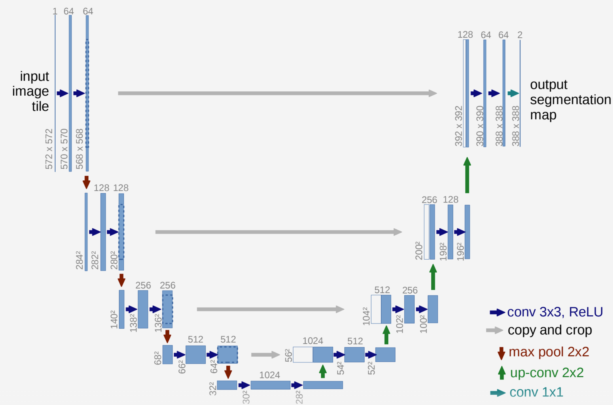

### Feasability report
Note: This report represents the ambitions of the project but was not fully implemented
1. User Need & Scope
The beneficiaries of the model are MRI patients and the medical professionals who need to interpret the MRI scans. The intended user would eventually be the medical professional, who can use the tool to help identify and confirm points of concern, boundary leakages, or areas of potential cancer concern.
The goal is to implement a 3D U-Net model on HipMRI data and achieve a Dice score greater than or equal to 0.7. The model will then be compared against a 2D model to determine whether the additional GPU memory usage and runtime are justified by reductions in hazardous boundary and slice transition errors.
Acceptance Criteria
1.	The 3D model achieves an average Dice score of ≥ 0.7 across all patients.
2.	The Dice score of the 3D model is compared against the Dice score of the 2D model.
3.	The 3D model demonstrates improvement in boundary localisation and/or reduction of slice transition errors compared with the 2D model.
4.	Runtime remains below a 10× increase compared with the 2D model.
5.	RAM usage remains below a 10× increase compared with the 2D model.
________________________________________
2. Model Choice & Course Concepts
Model Choice
A 3D Attention U-Net model will be used (Medium difficulty) with architecture approx:
•	3 × 3 × 3 convolutions
•	ReLU activation
•	Batch normalisation
•	2 × 2 × 2 max pooling
•	Skip connections
Attention U-Net Concept
The Attention U-Net is intended to assist with boundary localisation and class disambiguation.
Attention gates take two inputs:
•	the downsampled feature map
•	the skip connection
These inputs are convolved to generate attention coefficients, which are applied before upsampling. The intention is to focus on relevant features while reducing the influence of redundant features.
Supporting Literature
The proposed architecture is supported by:
•	3D U-Net Architecture
•	Attention U-Net: Learning Where to Look for the Pancreas
•	A-UNet: Attention 3D UNet architecture for multiclass segmentation of Brain Tumor
Dataset Configuration
The dataset will be split at the patient level with normalisation and padding.
Also augmentations random rotations and random flips. Any transformations applied to the images will also be applied to the corresponding masks.
________________________________________
3. Preliminary Feasibility Evidence
The baseline model will be a standard 3D U-Net. An initial estimate suggested:
•	6–10 GB VRAM
•	Several hours of training time
This may limit the feasibility of training an Attention U-Net.
No trained model has been produced at this stage. The next objective is to establish a working 2D U-Net baseline. 
________________________________________
4. Risks, Budget & Fallback
Risks
GPU Memory Usage
3D models may require a large amount of GPU memory.
Mitigation strategies, in order, are:
1.	Reduce batch size.
2.	Use mixed precision training.
3.	Reduce network depth.
4.	Reduce the number of data points.
Attention Mechanism Risk
Attention mechanisms may focus on incorrect regions of the image, reducing effectiveness. If the Attention U-Net is not feasible due to resource requirements or implementation complexity, the project will continue using a standard 3D U-Net and compare it against a 2D U-Net. The next experiment is to investigate the addition of a residual component to the model.

### Dependencies and Reproducability
The implementation was developed in Python using the PyTorch deep learning framework. Medical image volumes and segmentation masks stored in NIfTI format were loaded using NiBabel, while NumPy was used for numerical processing and preprocessing operations. Visualisations of predictions, overlays, training curves, and failure cases were produced using Matplotlib. Training was performed using the Adam optimiser with GPU acceleration provided through CUDA-enabled PyTorch operations when available.

All source code was maintained within a Git repository to ensure experiments could be reproduced and tracked throughout development. Initial proof-of-concept experiments were conducted locally using CPU execution and reduced datasets, while final experiments were executed on the Rangpur high-performance computing cluster using NVIDIA A100 GPUs.

### Example (in, out visual plots)
The input to the proposed system consists of pelvic MRI scans represented either as individual two-dimensional slices or as complete three-dimensional MRI volumes. Associated ground-truth segmentation masks are provided for six anatomical classes: Background, Body, Bone, Bladder, Colon, and Prostate.

Representative examples are automatically generated during evaluation, together with the highest-performing and lowest-performing predictions. These visualisations are used to qualitatively assess segmentation accuracy and identify common failure cases such as boundary leakage and incorrect anatomical classification.

Figure 2: 2D example
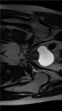

Using a 3D MRI viewer (https://www.neuropsis.org/nifti_viewer.html) an example input can be visualised by a 3 cross sections.
Figure 3: 3D slice example
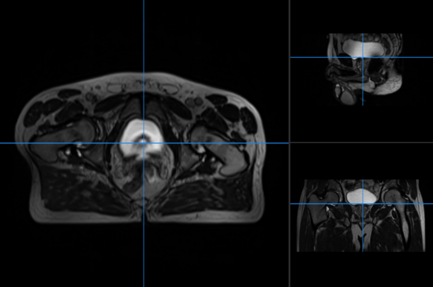

### Pre processing
MRI images were loaded from the provided NIfTI (.nii) files using the supplied dataset conversion utilities. Image intensities were normalised prior to training to reduce variation between scans and improve training stability. For the 2D implementation, segmentation labels were converted into a fixed six-channel categorical representation to support the Binary Cross-Entropy and Dice loss training objective. In contrast, the 3D segmentation masks were retained as integer class labels, as required by the Cross Entropy loss function.

To ensure consistent network inputs, images were resized to a common resolution. The final input dimensions for the 2D model were 256 × 144 pixels, while the 3D model operated on volumes of 144 × 256 × 256 voxels. Ground-truth segmentations were resized using nearest-neighbour interpolation to preserve class labels, while MRI images used interpolation methods suitable for continuous image data.

The provided 2D dataset was supplied with predefined training, validation, and testing partitions. The 3D dataset required manual partitioning and was split at the patient level using a 70%, 15%, 15% training, validation, and testing allocation with random seed of 42. This split was selected to maximise the amount of training data available while maintaining sufficient validation and testing samples for model selection and final evaluation. A patient-level split also prevents information leakage between subsets by ensuring that different scans from the same patient cannot appear in multiple partitions.

## Open Research Dilemma:
### Benchmarking & Resource Profiling
Total Training time: 58.57s on 35 epochs with batch 16
| Model | Dice | IOU | Peak GPU (GB)| Average Inference time (s) |
| ----- | ---- | --- | -------- | -------------- |
|  2D  | 0.8927 | 0.8225 | 3.64 | 0.0028s |
|  3D  | 0.8586 | 0.7720 | 9.14 | 0.0157s |

Training Times (in seconds) on 40 epochs
| Model | Batch Size | Min Epoch Time | Max Epoch Time | Average Time per Epoch |
| ---- | --- | ---| --- | --- |
| 2D | 1 | 0.02 | 151.22 | 58.9 |
| 3D | 1 | 26.24 | 134.41 | 130.32 |

Losses
Finale loss comparison
| Model | Training Loss | Validation Loss | 
| ----- | ------------- | --------------- | 
|  2D  | 0.0111 | 1.2622 |
|  3D  | 0.0271 | 0.1564 |

### 2D Plot analysis
Figure 4: Dice scores plotted against epochs for the 2D Unet
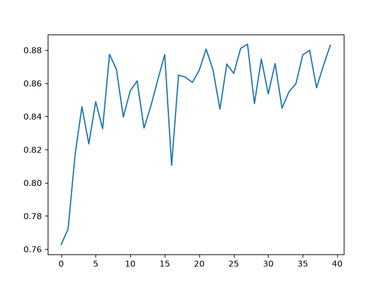
The dice plot in figure 4 shows that there is a rapid increase in the intial 4 epochs followed by a steatdy increase on average. There is a noticable inconsistancy in the score at each epoch however the model does finish with a dice score of 0.89. The variation appears rather drastic, but all scores after the first few epochs are all greater than 0.8. This shows promising results as few epochs are needed for a high dice score, but precision around what dice score the model will end up with is lacking.

Figure 5: Losses plotted against epochs for the 2D Unet
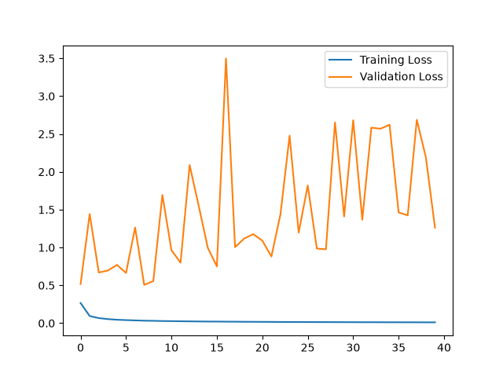
For the training, there is a smooth decline that approaches zero. This shows that the model is training effectively. However, the validation loss has a steadly increasing base line with a spiking behavour. With this divergence of the validation scores reaching 3.5 at one epoch, and the decreasing training loss the model appears to be overfitting.

Although validation loss remained unstable, the Dice coefficient continued to improve and stabilised at approximately 0.88. This suggests that the model maintained reasonable segmentation quality despite evidence of overfitting in the loss curves. Consequently, Dice score provides a more meaningful assessment of segmentation performance than loss alone.

### 3D Plot analysis
Figure 6: Dice scores plotted against epochs for the 3D Unet
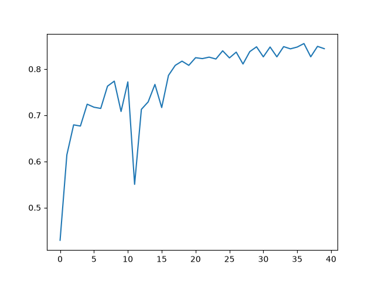
This dice plot shows promising results. Firstly it appears for the best dice values at least 20 epochs need to be run. Besides epoch 11, there appears to be a steady increase in the dice score approach 0.9. 

Figure 7: Loss pltted against epochs for the 3D Unet
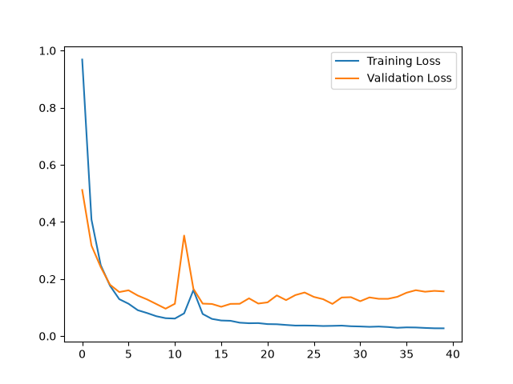
As you can see from figure 7, the training loss has a sudden yet smooth drop in the first few epchs followed by a steady decrease towards zero. The validation loss follows the training loss much closer compared to the 2D Unet. However there is still a steadily increasing divergence from approximatly 15 epochs. This indicates the model may be steadily overfitting when given more epochs.

A noticeable spike in validation loss occurred around epoch 11, accompanied by a temporary reduction in Dice score. Because both metrics recovered rapidly in subsequent epochs, indicating that this may just be a random variation in the training rather than a systematic issue.

Although the 2D U-Net achieved a slightly higher final Dice score, it exhibited substantial divergence between training and validation loss, indicating overfitting. In contrast, the 3D U-Net produced more stable validation performance and a smaller training-validation gap. This suggests that incorporating volumetric information improved generalisation, even though the final Dice coefficient was marginally lower. Consequently, the 3D U-Net appears to provide a more robust segmentation model overall.

### Error autopsies
#### 2D
Figure 8, 9, 10: Three worst performing slices from the model
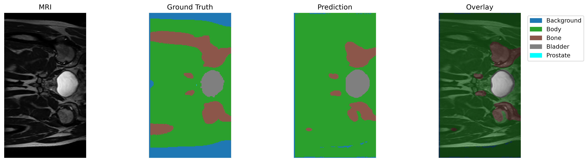
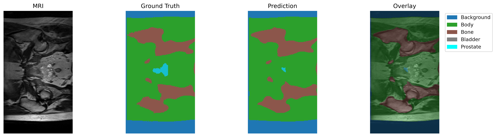
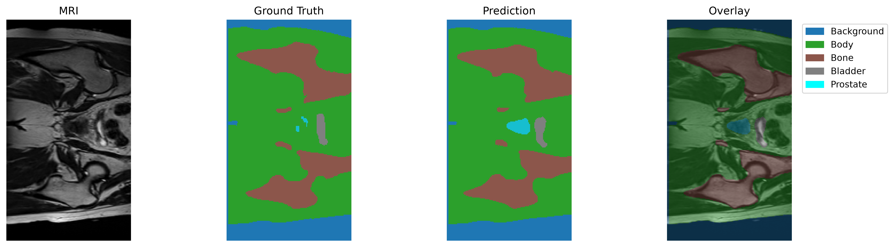
Figure 8 and 9 indicate some underfitting at prediction. It can be seen that the leg bones are simply missing from the prediction in figure 8. In figure 9 the prostate is signifivantly smaller having missed most of the gland.
Figure 10 actually shows som overfitting compared to the ground truth. I do however question the accuracy of the ground truth in this instance as the marked prostate is split and small compared to the characteristic shadows that have marked it in other MRI images.

Figure 11, 12, 13: Three best performing slices
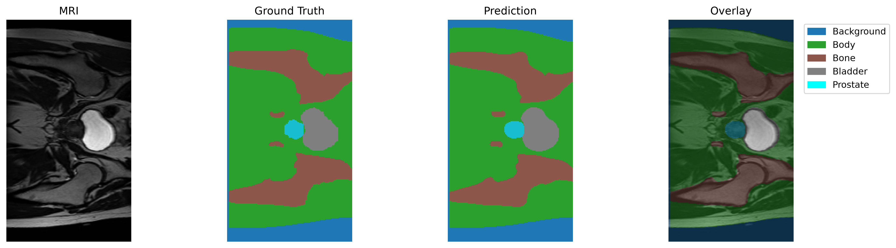

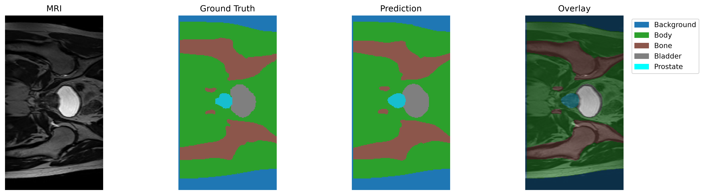
Observing the overlay of these models show that the trained model is picking up the correct details of the MRI. It is not a perfect replication of the ground truth with some sections being more rounded. However, as previously discussed the ground truths may not be completly accurate.

#### 3D
For error autopsies in 3D, we observe the weakest and strongest scoring predictions, and within those the weakest and strongest slices respectivly.

Figure 14, 15, 16: Worst slices of the worst prediction in the 3D Unet
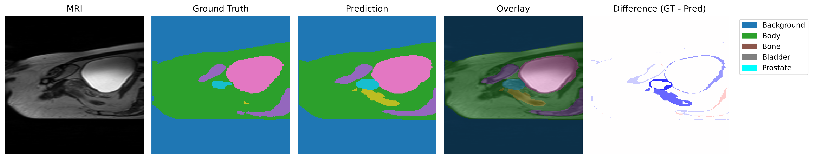
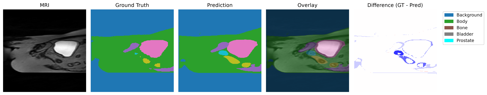
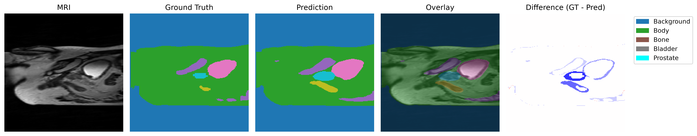
Firstly note that for all these models the key is missing some of the sections. I did not have time to rerun the model with a correct key, so the following is the fix:
Yellow -> Rectum
Pink -> Bladder
Darker pink -> Bone

Similar to the 2d model, the differences are mostly a result from overfitting and rounding out the sections.
The overfitting is especially prevalent in figure 14 as the ground truth has a very small yellow section. However, similar to the 2D autopsie, the ground truth doesn't seem too reliable compared to the shadowing in the MRI. This is easily visible in the overlay.

Figure 17, 18, 19: Best slices of the best prediction in the 3D Unet
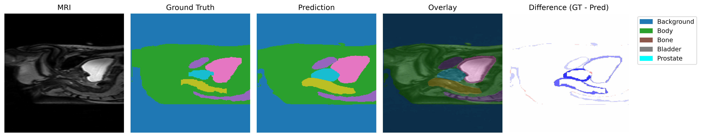
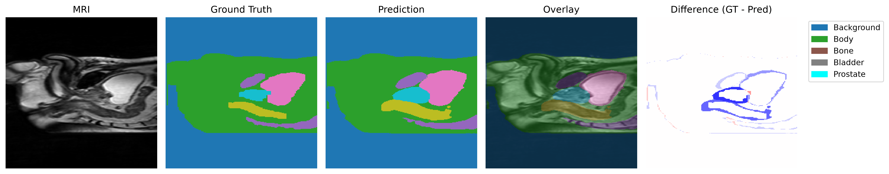
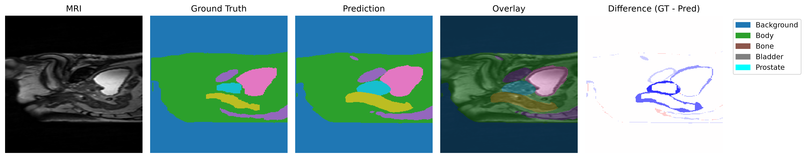
In these we can see overfitting occuring even with the ground truth being accurate. In all figures 17-19 the sections are more rounded with less space between them.

### Recomendations and trade offs
From the two Unet models the main trade offs are segmentation accuracy, robustness or computational efficiency.

Overall the 2D Unet did achieve a higher dice score indicating better accuracy and IoU of 0.8225. It also had a substantially smaller amount of GPU memory of 3.64 GB compared to the 9.14 GB of te 3D Unet. Similarly the inference time was much smaller sitting at 0.0028 seconds compared to the 0.0157 seconds on the 3D model.

However the learning curve indicates that the 2D approach suffers form overfitting considerably more than the 3D model due to the validation loss. While the 3D Unet does show evidence of overfitting it is less and more consistant than the 2D model.

Therefore, for a model that requires fast execution time with limited memory usage then the 2D Unet is the best option. However, if robustness and generalisation is more desireable than the 3D Unet provides a stronger approach at the expense of approximatly 2.2 times the time and 2.5 times the memory.

Overall, for this dataset and these models, the 2D U-Net provides the best accuracy-to-computational-cost ratio, while the 3D U-Net offers the more robust learning behaviour.

### Discusion
The 2D U-Net occasionally misses structures entirely and exhibits slice-wise inconsistencies due to the lack of adjacent slice information. The 3D U-Net reduces these discontinuities by incorporating volumetric context across neighbouring slices. However, the improvement comes at a substantial computational cost and does not completely eliminate boundary leakage or contour smoothing.

### AI disclosure
GitHub Copilot for auto complete
Copilot for Unet model structure - checked by comparison with other models found during research Ref (1, 2, 3)
Copilot was used for editing the report - creating sentences given dot points or specification I wrote. 

All output was read and verified before use.

### References:
1. ReferencesChornyi, A. (2024). 2D and 3D u-net architectures. Codefinity. https://codefinity.com/blog/2D-and-3D-U-Net-Architectures
2. Schmidt, J. (2020, December 2). Creating and training a u-net model with PyTorch for 2D & 3D semantic segmentation: Model building... | Towards data science. Towards Data Science. https://towardsdatascience.com/creating-and-training-a-u-net-model-with-pytorch-for-2d-3d-semantic-segmentation-model-building-6ab09d6a0862/
3. Sovit Ranjan Rath. (2023, April 3). Implementing UNet from scratch using PyTorch. DebuggerCafe. https://debuggercafe.com/unet-from-scratch-using-pytorch/

